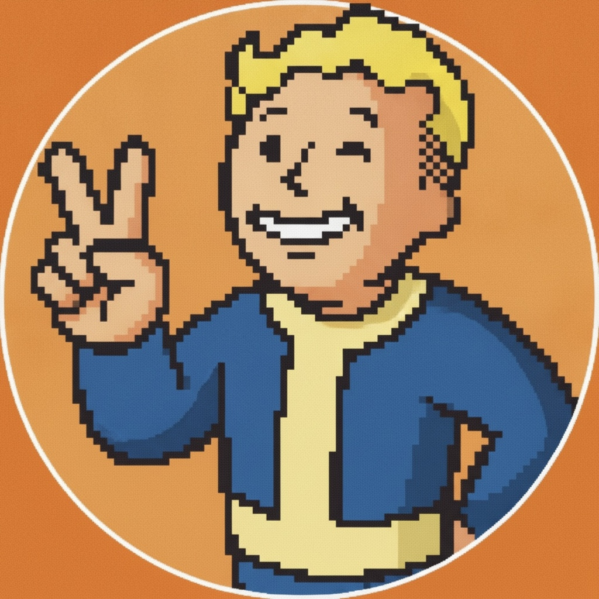

  

<h1 align="center">VaultOS</h1>

  Fallout and Fallout 2, on iOS

  

  

## Features

- Fallout and Fallout 2 in one app, each with its own install and saves
- Runs natively: no JIT, no entitlements
- A ZIP of your own game files is all it needs; the app ships no game data
- Touch controls you can move, resize, fade and colour
- Language packs and savegame backups handled in the launcher

## Install

1. Get the latest [release](https://github.com/shplash/vaultos/releases).
2. Sideload the IPA with AltStore, SideStore, Feather, LiveContainer or
   TrollStore. LiveContainer needs its **Fix File Picker** option turned on, or
   the file picker will not open.

## Requirements

- iOS 14 or newer
- Your own copy of Fallout and/or Fallout 2. Nothing is included or downloaded.

## Game files

Zip the game once, then import that ZIP in the launcher. Either the game folder
itself, or one folder around it (`Fallout/`, `Fallout2/`).

| Game | The ZIP needs |
| --- | --- |
| **Fallout** | `master.dat` `critter.dat` `data/` |
| **Fallout 2** | `master.dat` `critter.dat` `patch000.dat` `data/` |

Each game keeps its own files and saves: `Documents/` for Fallout,
`Documents/Fallout2/` for Fallout 2, both show up in the Files app. Saves live in
`data/SAVEGAME` inside that folder, one `SLOT01`, `SLOT02`… per save.

## In the launcher

- **LANGUAGE FILES** adds a translation pack you supply
- **BACK UP** writes `fo(1/2)-save-backup-(date).zip` into the game's folder.
  **IMPORT** replaces the saves

## Notes

Unofficial. Fallout is a trademark of Bethesda Softworks, not affiliated with
Bethesda or Interplay.

VaultOS is a modified version of Alexander Batalov's Fallout Community Edition
engines ([Fallout CE](https://github.com/alexbatalov/fallout1-ce),
[Fallout 2 CE](https://github.com/alexbatalov/fallout2-ce)): the launcher, the
iOS port and the touch controls are this project's, and the Fallout 1 sources
here are the engine with those changes in them.

The code is under the [Sustainable Use License](LICENSE.md), which is not the
whole of what the app carries: the Anton font is under the SIL Open Font
License, SDL is under the zlib licence, the two link icons are MIT and CC BY 4.0,
and the bundled artwork and music are not part of the licensed source. See
[third_party](third_party/README.md).

## Support

  

If VaultOS has been useful to you, you can support its development as well as
future projects.
